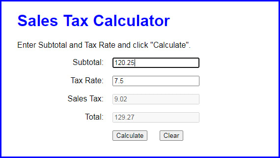

# Sales Tax Calculator

Build a calculator that accepts an invoice subtotal and a tax rate entered as a percentage. When the user clicks **Calculate**, display the sales tax and invoice total in their respective text boxes.

## Expected result

To reproduce the example, enter `120.25` for **Subtotal** and `7.5` for **Tax Rate**, then click **Calculate**. The calculator multiplies the subtotal by the tax rate divided by 100, then adds the tax to the subtotal. Display both results to two decimal places.

## Assignment steps

1. Run the starter application to inspect the interface shown above. The controls become functional once you implement the JavaScript.
2. Locate the provided `$()` function in the JavaScript file. It takes a CSS selector and returns the corresponding HTML element.
3. Write an event handler named `processEntries()`. Read the subtotal and tax rate, calculate the sales tax and invoice total, and display both results in the corresponding text boxes.
4. In a `DOMContentLoaded` event handler, attach `processEntries()` to the **Calculate** button’s `click` event. Test the calculation using the example above.
5. Add validation to `processEntries()`. Both entries must be valid numbers within the strict limits below. For an invalid entry, display the exact message in an alert dialog.

   | Field | Valid range | Alert message |
   | --- | --- | --- |
   | Subtotal | Greater than 0 and less than 10,000 | `Subtotal must be > 0 and < 10000` |
   | Tax Rate | Greater than 0 and less than 12 | `Tax Rate must be > 0 and < 12` |

6. Move keyboard focus to **Subtotal** when the application starts and each time the user clicks **Calculate**.
7. Add a `click` handler for **Clear** that empties all four text boxes and returns focus to **Subtotal**.
8. Add a `click` handler to each input field so clicking **Subtotal** or **Tax Rate** clears only that field. Reuse those handlers in the **Clear** button handler to avoid duplicating the input-clearing logic.
