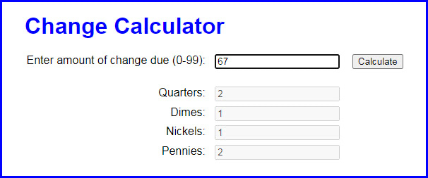

# Change Calculator

Build a calculator that takes a whole-cent amount from 0 through 99 and displays how many quarters, dimes, nickels, and pennies are needed to make that amount.

## Expected result

Enter `67` and click **Calculate**. The result is 2 quarters (50¢), 1 dime (10¢), 1 nickel (5¢), and 2 pennies (2¢), for a total of 67¢.

## Assignment steps

1. Run the application to inspect the interface shown above. The controls become functional once you implement the JavaScript.
2. Locate the provided `$()` function in the JavaScript file.
3. Write an event handler named `processEntry()`. Read the entered amount and check that it is a number from 0 through 99, inclusive. If valid, pass the amount to `makeChange()`. Otherwise, display an error in an alert dialog.
4. Write `makeChange()` with one parameter for the amount. Display the four coin counts in the **Quarters**, **Dimes**, **Nickels**, and **Pennies** text boxes. The function returns no value.
5. In a `DOMContentLoaded` event handler, attach `processEntry()` to the button’s `click` event, then test the application. The instructions call this button **Make Change**. Its label in the screenshot is **Calculate**.

## Calculation hint

Start with quarters and work down to pennies. For each coin, divide the remaining cents by the coin’s value and use `parseInt()` to truncate the quotient to a whole number. Use the remainder operator (`%`) to find the cents left for the next coin. For example, `parseInt(67 / 25)` gives 2 quarters, and `67 % 25` leaves 17 cents.
