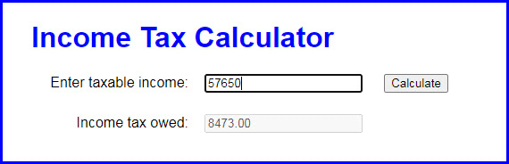

# Income Tax Calculator

Use nested `if` statements and arithmetic expressions to calculate the federal income tax owed for a taxable income amount using the assignment’s 2020 tax table.

## Expected result

Enter `57650` and click **Calculate**. The income tax owed is `8473.00`.

## Assignment tax table

Use this 2020 table supplied in the assignment.

| Taxable income over | But not over | Base tax | Rate on excess | Excess over |
| --- | --- | --- | --- | --- |
| $0 | $9,875 | $0 | 10% | $0 |
| $9,875 | $40,125 | $987.50 | 12% | $9,875 |
| $40,125 | $85,525 | $4,617.50 | 22% | $40,125 |
| $85,525 | $163,300 | $14,605.50 | 24% | $85,525 |
| $163,300 | $207,350 | $33,271.50 | 32% | $163,300 |
| $207,350 | $518,400 | $47,367.50 | 35% | $207,350 |
| $518,400 | No upper limit | $156,235.00 | 37% | $518,400 |

For the applicable bracket, calculate the tax as the base tax plus the rate multiplied by the income above that bracket’s excess threshold.

## Assignment steps

1. Inspect the starting JavaScript, including the `$()` function and the `DOMContentLoaded` handler. The handler already attaches `processEntry()` to the **Calculate** button’s `click` event and moves focus to the first text box.
2. Implement `processEntry()`. Read the user’s entry and validate that it is a number greater than zero. Display an error message for an invalid entry. For a valid entry, pass the value to `calculateTax()`, receive the returned tax amount, and display it in the second text box. Move focus to the first text box whether the entry is valid or invalid.
3. Implement `calculateTax()`, initially supporting the first two tax brackets. Convert the user’s entry to an integer and round the tax to two decimal places. Test with incomes of `9875` and `40125`, which should produce tax amounts of `987.50` and `4617.50`.
4. Add support for the next tax bracket. If time permits, add the remaining tax brackets.

## Example calculations

| Taxable income | Calculation | Income tax owed |
| --- | --- | --- |
| 9,875 | 9,875 × 10% | 987.50 |
| 40,125 | 987.50 + (40,125 − 9,875) × 12% | 4,617.50 |
| 57,650 | 4,617.50 + (57,650 − 40,125) × 22% | 8,473.00 |
