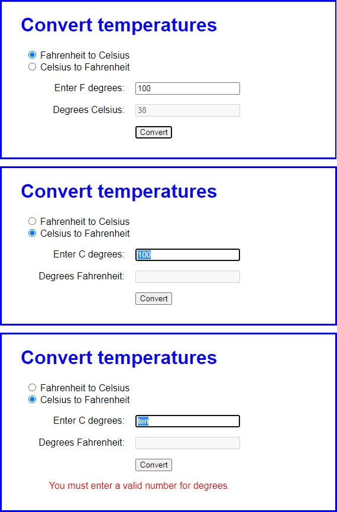

# Temperature Converter

Use radio buttons to select Fahrenheit-to-Celsius or Celsius-to-Fahrenheit conversion. Update the DOM so the input and output labels match the selected direction, and display an error message for invalid input.

## Expected results

The image below combines the assignment’s three screenshots, showing both conversion directions and the invalid-input message.

## Assignment steps

1. Inspect the starting JavaScript. It includes the `$()` function, three helper functions, three event handlers, and a `DOMContentLoaded` handler that attaches those event handlers.
2. Review how the `toCelsius()` and `toFarhenheit()` event handlers call `toggleDisplay()` with the strings to display. The `toggleDisplay()` and `convertTemp()` functions are incomplete. The name `toFarhenheit()` follows the spelling used in the assignment.
3. Complete `toggleDisplay()` so it updates the labels for both text boxes using its parameters and clears the disabled result text box.
4. Complete `convertTemp()`, initially without validation. Use the helper functions to calculate the temperature according to the selected radio button. Round the returned result to zero decimal places.
5. Add input validation to `convertTemp()`. Display the validation message in the element whose ID is `message` when the input is invalid. Use the message shown in the screenshot, `You must enter a valid number for degrees.`
6. Add appropriate finishing touches, such as focusing the first text box and selecting its text, clearing an earlier error message, and clearing an earlier computed temperature.

## Conversion formulas

| Direction | Formula |
| --- | --- |
| Fahrenheit to Celsius | (°F − 32) × 5 / 9 |
| Celsius to Fahrenheit | °C × 9 / 5 + 32 |

Display the converted value rounded to a whole degree.
