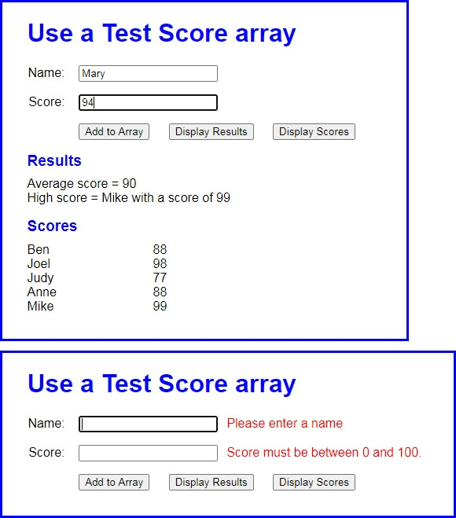

# Test Score Array

Work with arrays of names and scores, and add nodes to the DOM to display the results and individual scores. Allow users to add a name and score, and display validation messages beside invalid inputs.

## Expected results

The image combines the assignment’s result and validation screenshots.

The result example lists Ben (88), Joel (98), Judy (77), Anne (88), and Mike (99). The average is 90, and Mike has the highest score of 99. Mary and 94 appear in the input fields in this screenshot.

## Assignment steps

1. Run the application to inspect its interface. The controls become functional once you implement the JavaScript.
2. Inspect the starting JavaScript. It declares two arrays, one for names and one for scores, each initially containing four elements. It also provides `$()` and a `DOMContentLoaded` handler that attaches `addScore()`, `displayResults()`, and `displayScores()` to their buttons’ click events.
3. Implement `displayResults()`. Derive the average and highest score from the arrays, then display them in the `div` with ID `results`. Add a heading as an `h2` node and the average and highest-score details as `p` nodes. Include the highest-scoring person’s name, as shown in the screenshot. Replace existing result nodes when the button is clicked again.
4. Implement `displayScores()`. Read the names and scores from the arrays and display them in the `div` with ID `scores`. Create label elements for each name and score, with a `br` element to begin the next line. Clear previous nodes by setting the container’s text content to an empty string before adding the new nodes.
5. Implement `addScore()`. Add the entered name and score to their corresponding arrays. Test by clicking **Display Scores** and checking that the new pair appears.
6. Add validation to `addScore()`. The name must be nonempty, and the score must be a valid number from 0 through 100, inclusive. Display messages in the `span` elements after the inputs when either entry is invalid.
7. Move focus to the **Name** field when the application starts and after a name and score have been added.

## Validation messages

| Field | Requirement | Message shown in the assignment |
| --- | --- | --- |
| Name | Must not be empty | Please enter a name. |
| Score | Must be a number from 0 through 100 | Score must be between 0 and 100. |

The assignment describes the score as a “positive number from 0 through 100.” The stated range and screenshot include zero, so the valid range here includes both 0 and 100.

## Interface buttons

| Button | Event handler | Action |
| --- | --- | --- |
| Add to Array | `addScore()` | Validate and add a name and score |
| Display Results | `displayResults()` | Show the average and highest score |
| Display Scores | `displayScores()` | Show the stored names and scores |
