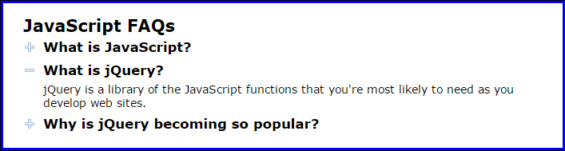

# JavaScript FAQs

Modify the existing FAQs application so that only one answer can be displayed at a time. When the user clicks a heading to display its answer, hide any other displayed answers. Preserve the application’s existing toggle behavior.

## Expected result

The screenshot shows **What is jQuery?** expanded while the other two answers are hidden.

## Assignment steps

1. Run the application to review how it currently works.
2. Update the `toggle()` function so that only one answer can be displayed at a time. Create an array of the `h2` elements, then use a `for...of` loop to visit each heading. For every heading other than the one clicked, remove its `class` attribute. Also remove the `class` attribute from its sibling `div` containing the answer.

## Required behavior

- Clicking a collapsed heading displays its answer and hides the other answers.
- Clicking an expanded heading retains the existing toggle behavior and collapses its answer.
- The expanded or collapsed appearance of each heading matches its answer’s visibility.
- At most one answer is visible at any time.

## Manual checks

1. Click **What is JavaScript?** and confirm its answer appears.
2. Click **What is jQuery?** and confirm its answer appears while the JavaScript answer closes.
3. Click **Why is jQuery becoming so popular?** and confirm its answer appears while the others are hidden.
4. Click the currently expanded heading again and confirm it collapses.
