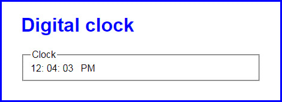

# Digital Clock

Create an application that displays the current time in hours, minutes, and seconds. Use a 12-hour clock with an AM or PM indicator, and update the display every second.

## Expected result

The assignment screenshot shows the digital clock displaying 12:04:03 PM.

## Assignment steps

1. Review the supplied JavaScript. It includes the `$()` function for selecting elements, `padSingleDigit()` for adding a leading zero to single digits, the beginning of `displayCurrentTime()`, and the beginning of a `DOMContentLoaded` event handler.
2. Complete `displayCurrentTime()`. Use a `Date` object to obtain the current hour, minute, and second. Convert the hour to a 12-hour value, determine whether it is AM or PM, and display the values in the appropriate `span` elements. Use the supplied padding helper where needed.
3. Complete the `DOMContentLoaded` handler. Display the current time immediately when the page loads, then start a timer that calls `displayCurrentTime()` at one-second intervals.

## Converting to a 12-hour clock

Determine AM or PM from the original 24-hour value. Hours from 0 through 11 are AM, and hours from 12 through 23 are PM. Subtract 12 when the hour is greater than 12, and display hour 0 as 12.

| Computer time | Clock display |
| --- | --- |
| 00:00:00 | 12:00:00 AM |
| 09:05:07 | 9:05:07 AM |
| 12:00:00 | 12:00:00 PM |
| 15:04:03 | 3:04:03 PM |
| 23:59:59 | 11:59:59 PM |

*Note:* mentions setting PM when the hour is greater than 12. Noon also requires PM, as reflected in the table above.

## Timer behavior

Call `displayCurrentTime()` once during initialization so the clock appears immediately. Use `setInterval(displayCurrentTime, 1000)` to refresh it every second. Read the current time from a new `Date` object on each refresh.

## Manual checks

- Confirm that the time appears as soon as the page loads.
- Confirm that the seconds update continuously.
- Check that single-digit minutes and seconds have leading zeros.
- Check the AM/PM value and the midnight and noon conversions.
