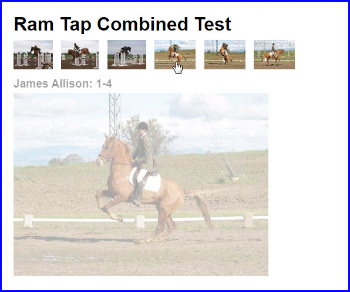

# Image Swap with Fade Effects

Modify the Image Swap application to use jQuery effects when hiding and displaying images and their captions. The current image and caption should fade out before the selected image and caption fade in.

## Expected result

The assignment screenshot shows the **Ram Tap Combined Test** gallery, with six thumbnails and a larger image and caption during a fade transition.

## Assignment steps

1. Review the script tags in the HTML file. The application loads the full jQuery build so that jQuery effects are available.
2. Review the JavaScript, which starts with the same code as the Chapter 8 Image Swap application. Run the application to see its existing behavior.
3. Add statements to fade the current caption and image out over one second.
4. Modify the statements that display the new caption and image so they fade in over one second. Run this intermediate version and observe the timing problem. The new caption and image appear before fading out and back in.
5. Add a callback function to the statement that fades out the image. Move the statements that display the new caption and image into this callback. The old caption and image should now fade out before the new caption and image fade in.

## Effect timing

| Phase | Action | Duration |
| --- | --- | --- |
| Fade out | Hide the current caption and image | 1 second |
| Update | Set the selected image and caption inside the image’s fade-out callback | After fade-out completes |
| Fade in | Reveal the new caption and image | 1 second |

Use a duration of `1000` milliseconds for the jQuery fade effects. The callback controls when the displayed content changes.

## Manual checks

- Open the page and select a different thumbnail.
- Confirm that the current image and caption fade out over one second.
- Confirm that the selected image and caption appear through a one-second fade-in after the fade-out completes.
- Select another thumbnail and confirm that the image and caption match the selection.
