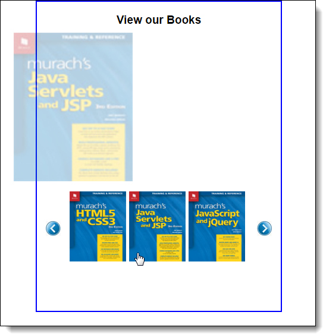

# Animated Book Carousel

Modify the carousel application so clicking a book image displays its enlarged image with animation. The current enlarged image should fade out while sliding left, then the selected image should fade in while sliding right.

## Expected result

The assignment screenshot shows the **View our Books** carousel and an enlarged book image during the slide-and-fade transition.

## Assignment steps

1. Run the application. Notice that the first book in the carousel already appears as an enlarged image.
2. Review the HTML. An `img` element with ID `image` follows the heading. Each carousel link’s `href` contains the URL of the enlarged image associated with that thumbnail.
3. Add a click event handler for the `a` elements in the list. Retrieve the selected link’s image URL and assign it to the enlarged image.
4. Add animation to the click handler. Over one second, animate the current image’s opacity to `0` and decrease its left margin by `205` pixels. Use a callback to reverse the animation, restoring opacity and moving the image right. Place the statement that assigns the selected image URL inside that callback so the image changes after the outgoing animation finishes.

## Animation sequence

| Phase | Image | Opacity | Left margin |
| --- | --- | --- | --- |
| Outgoing animation | Current enlarged image | Animate to 0 | Decrease by 205 pixels over 1 second |
| Callback | Assign the selected link’s URL to the enlarged image | Remains hidden during the change | At the outgoing position |
| Reverse animation | Newly selected enlarged image | Restore to 1 | Increase by 205 pixels to return to its original position |

The callback keeps the image change synchronized with the transition.

## Manual checks

- Load the application and confirm that the first book’s enlarged image is visible.
- Click another book thumbnail and confirm that the current image fades out while sliding left.
- Confirm that the selected book then fades in while sliding right to the original position.
- Repeat with another thumbnail and check that the enlarged image matches the selected book.
