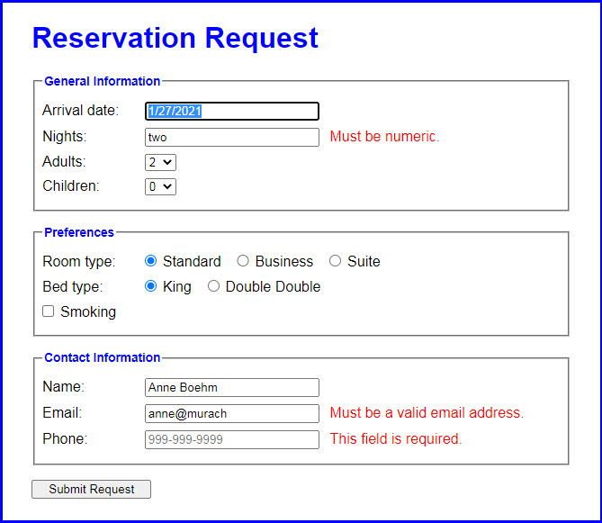

# Reservation Request Form Validation

Use JavaScript to validate a reservation request form before submission. Trim the text entries, check the required fields, validate the number of nights and email address, and cancel submission when any entry is invalid.

## Expected result

The assignment screenshot shows validation messages for a nonnumeric number of nights, an invalid email address, and an empty phone field.

## Assignment steps

1. Run the application and click **Submit Request** to inspect the page displayed when the form is submitted to the server.
2. Review the JavaScript. The ready event handler declares an `emailPattern` constant containing the pattern to use when validating email addresses.
3. Add a statement that moves focus to the **Arrival date** text box.
4. Add a handler for the form’s `submit` event. Validate the entries and cancel form submission if any entry is invalid. Every text box requires a value, the number of nights must be numeric, and the email address must match the provided pattern. Trim every text entry and write the trimmed value back to its control regardless of whether it passes validation.

## Validation requirements

| Field | Required validation |
| --- | --- |
| Arrival date | Must contain a value after trimming |
| Nights | Must contain a value after trimming and be numeric |
| Name | Must contain a value after trimming |
| Email | Must contain a value after trimming and match `emailPattern` |
| Phone | Must contain a value after trimming |

Use the supplied email pattern from the starter code.

## Messages shown in the assignment

| Condition | Message |
| --- | --- |
| Empty required field | This field is required. |
| Nonnumeric nights | Must be numeric. |
| Invalid email | Must be a valid email address. |

The form also contains selectors for adults and children, room and bed preferences, and a smoking checkbox, as shown in the screenshot.

## Manual checks

- Confirm that **Arrival date** receives focus when the page loads.
- Submit empty text fields and confirm that required-field validation prevents submission.
- Enter `two` for nights and confirm that numeric validation prevents submission.
- Enter an email that fails the supplied pattern and confirm that email validation prevents submission.
- Enter values with surrounding spaces and confirm that the trimmed values appear in the controls, including when another field is invalid.
- Complete all text fields with valid values and confirm that the form submits.
