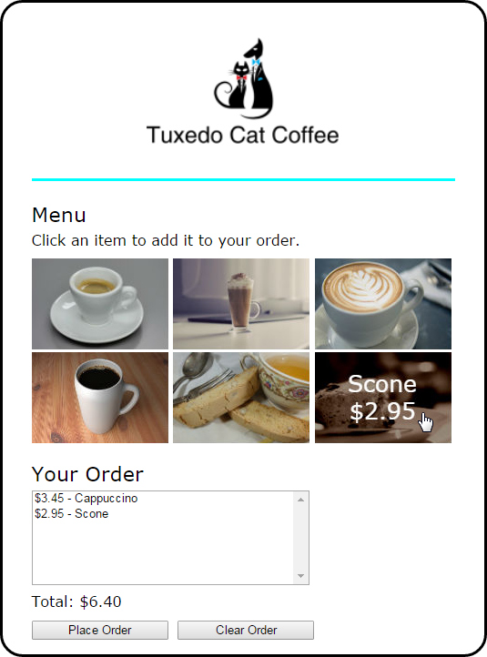

# Tuxedo Cat Coffee Order Application

Create an application that allows customers to place an order at the fictitious Tuxedo Cat Coffee shop.

## Professor-approved approach

My professor allowed me to complete this assignment using a completely different approach. I built a shopping cart with product and cart-item classes, editable quantities, individual item removal, validation, and animated menu rollovers. The explanation and source code at the end of this README document my submitted implementation.

## Assignment reference interface

This screenshot shows the interface provided in the original assignment.

## Original assignment specifications

1. When the user hovers over a menu image, display its alternate image containing the item description and price. The image’s `id` identifies the alternate image.
2. Preload the rollover images.
3. Clicking a menu image updates and displays the order list and total.
4. Clicking **Place Order** displays `checkout.html`.
5. Clicking **Clear Order** removes all items and clears the total.

## How I implemented the application

### Products and cart state

I defined a `Product` class containing an ID, name, unit price, and image filename. The `products` array contains six menu items. A separate `CartItem` class holds a product and quantity, and its `getSubtotal()` method multiplies the unit price by the quantity.

The `cart` array is created inside the document-ready handler. Each menu link’s position selects the corresponding product. The menu order and product-array order therefore need to match. The `imageFile` property is stored on each product, while the current menu images come from the HTML.

### Adding products and rendering the cart

Clicking a menu link prevents its default navigation. The handler checks for a table row with the product’s `data-product-id`. If the product is already present, its row is highlighted yellow for one second. To increase its amount, the customer edits the quantity.

For a new product, the handler adds a `CartItem` with quantity 1 and calls `addItemHTMLTable()` to append a row with its name, quantity control, unit price, subtotal, and remove button. It then recalculates the total and shows the cart.

### Quantities and totals

`isValidQuantity()` checks that a quantity is nonempty, numeric, an integer, and between 1 and 99 inclusive. A delegated `change` handler on `#cart_items` handles quantity inputs added after page load.

An invalid quantity is highlighted, restored to its previous valid value, and has its highlight removed after one second. A valid quantity updates the associated `CartItem`, the row subtotal, and the total. `updateCartTotal()` uses `reduce()` to sum the cart-item subtotals. Prices are displayed to two decimal places with `toFixed(2)`.

### Rollover animation

For each menu link, I save the image’s original `src` and read its alternate image path from its `id`. On mouse entry, the image fades out for 500 milliseconds, switches to the information image, and fades in for 500 milliseconds. Mouse exit reverses the swap. The code uses `stop(true)` to clear queued effects before starting another transition.

### Removing and clearing items

A delegated remove-button handler finds the product, removes it from the cart with `splice()`, removes its table row, and refreshes the total. The cart is hidden when its last item is removed.

**Clear Order** empties the existing array with `cart.length = 0`, removes all table rows, and hides the cart. This preserves the array’s `const` binding.

### Submission and checkout

The submit handler checks all quantity inputs again and prevents submission if any quantity is invalid. Otherwise, the HTML form submits to `checkout.html` using GET. That page displays a thank-you message and a link to place another order.

### HTML and CSS

The HTML provides the menu, a hidden shopping-cart section, a table body for dynamically created rows, and the form buttons. The full jQuery 3.4.1 build is loaded from a CDN before `cafe.js`. The CSS styles the page, table, quantity controls, temporary duplicate-item highlight, and validation highlight.
