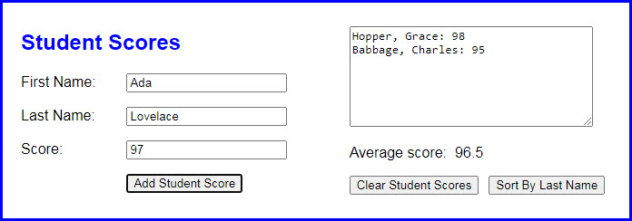

# Student Scores

Develop an application that tracks students’ scores, calculates the average of the entered scores, and sorts the displayed students by last name.

## Expected result

This screenshot shows the interface provided in the original assignment. The text area contains Grace Hopper’s score of 98 and Charles Babbage’s score of 95, producing an average of 96.5. Ada Lovelace’s details and a score of 97 are entered in the form.

## Assignment steps

1. Review the JavaScript. It includes the beginning of `displayScores()` and click handlers for **Add Student Score**, **Clear Student Scores**, and **Sort By Last Name** inside the ready event handler. The supplied add handler validates the input and, for valid data, clears the entry form and focuses its first field. The clear handler ends by clearing the display area and focusing the first-name field.
2. Declare two arrays outside these functions. Store numeric score values in the first array and strings containing student names and scores in the second.
3. Complete `displayScores()`. Calculate the average of all scores in the first array and display it in the label with ID `average_score`. Display the student-name-and-score strings from the second array in the text area.
4. Complete the **Add Student Score** handler. Use `push()` to add the score to the first array and the formatted name-and-score string to the second array. Call `displayScores()` to refresh the display.
5. Complete the **Clear Student Scores** handler by clearing both arrays.
6. Complete the **Sort By Last Name** handler by sorting the students by last name and redisplaying the score information.

## Data and display requirements

| Data or control | Purpose |
| --- | --- |
| Numeric scores array | Stores the values used to calculate the average |
| Name-and-score strings array | Stores the student entries displayed in the text area |
| First Name, Last Name, Score | Inputs used when adding a student |
| Text area | Displays one student entry per line |
| Label with ID `average_score` | Displays the calculated average |

Use the format shown in the screenshot for each student entry, such as `Hopper, Grace: 98`. Placing the last name first supports sorting the displayed strings by last name.

## Interface actions

| Button | Expected behavior |
| --- | --- |
| Add Student Score | Validate input, add the score and display string, refresh results, clear valid entries, and focus the first field |
| Clear Student Scores | Clear both arrays and the display area, then focus the first-name field |
| Sort By Last Name | Sort the displayed student entries by last name and refresh the results |

## Manual checks

- Add Grace Hopper with a score of 98 and Charles Babbage with a score of 95. Confirm that both entries appear and the average is 96.5.
- Add Ada Lovelace with a score of 97. Confirm that all three entries appear and the average updates.
- Click **Sort By Last Name** and confirm that Babbage, Hopper, and Lovelace appear in that order.
- Confirm that sorting preserves the student scores and average.
- Click **Clear Student Scores** and confirm that the entries are cleared and focus returns to the first-name field.
- Add a new student after clearing and confirm that the previous scores no longer affect the average.
