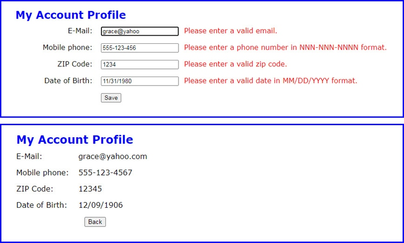

# Account Profile with an Array of Arrays

Adjust the Account Profile application to store profile data as an array of arrays. The completed application should retain its existing behavior.

## Expected result

This image combines the two screenshots provided in the original assignment. The first shows the editable profile form with validation messages. The second shows the saved profile details.

## Assignment steps

1. In `save_profile.js`, locate the **Save** button’s click handler and the code that saves profile data to session storage. Create an empty array. For each profile value, append an inner array containing the value and the `id` of the text box from which it came.
2. Change the storage code to save a single session-storage entry named `profile`. Use JSON to convert the array to a string before storing it.
3. In `display_profile.js`, locate the code that retrieves stored data and displays it on the page. Parse the stored JSON string back into an array of arrays. Loop through the entries and use each stored field identifier to populate the appropriate display element.

The PDF describes the display elements as spans, then refers to setting a text-box value in the same step. Use the corresponding elements in the supplied display page to preserve its existing behavior.

## Data structure and storage

Each inner array contains two pieces of data in the order specified by the assignment.

| Position | Content |
| --- | --- |
| 0 | The profile field’s value |
| 1 | The source text box’s ID |

The outer array contains one such pair for each profile field.

| Operation | JavaScript API |
| --- | --- |
| Convert the nested array to a JSON string | `JSON.stringify()` |
| Save the JSON under the profile key | `sessionStorage.setItem("profile", ...)` |
| Retrieve the stored JSON string | `sessionStorage.getItem("profile")` |
| Convert the JSON string back to an array | `JSON.parse()` |

Use the actual input IDs from the starter HTML when creating and reading the stored pairs.

## Existing interface

The profile contains **E-Mail**, **Mobile phone**, **ZIP Code**, and **Date of Birth** fields. Preserve the supplied validation and navigation behavior.

| Field | Validation message shown in the screenshot |
| --- | --- |
| E-Mail | Please enter a valid email. |
| Mobile phone | Please enter a phone number in NNN-NNN-NNNN format. |
| ZIP Code | Please enter a valid zip code. |
| Date of Birth | Please enter a valid date in MM/DD/YYYY format. |

The saved-profile screenshot shows `grace@yahoo.com`, `555-123-4567`, `12345`, and `12/09/1906`.

## Manual checks

- Enter invalid values and confirm that the existing validation messages appear.
- Enter valid profile data and click **Save**.
- Confirm that session storage contains a single `profile` entry holding the JSON-encoded array of arrays.
- Confirm that the display page shows each saved value in its corresponding field.
- Use **Back** and confirm that the application’s existing navigation behavior is preserved.
