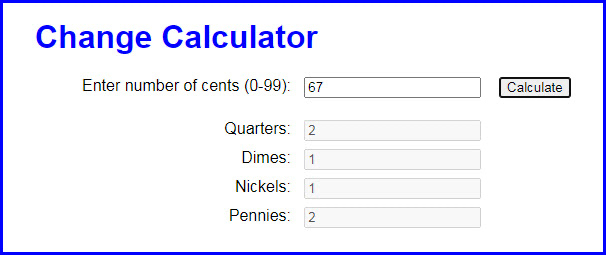

# Change Calculator with a Class

Modify the [Change Calculator application](https://github.com/fausto-gonzalez/javascript-coursework/tree/main/02_change_calculator) to use a class while preserving its existing behavior. The calculator converts an entered amount of cents into quarters, dimes, nickels, and pennies.

## Expected result

This screenshot shows the interface provided in the original assignment. Entering 67 cents produces 2 quarters, 1 dime, 1 nickel, and 2 pennies.

## Assignment steps

1. Review `calculate.js`. All existing application code is inside the **Calculate** button’s click handler.
2. Review `library_coin.js`. Initially, it contains only the strict-mode declaration.
3. Add a script tag for the library file to `index.html`.
4. In the library file, define a class named `Coins`. Its constructor must define `quarters`, `dimes`, `nickels`, and `cents` properties and initialize each to `0`. Add a `makeChange()` method that accepts an amount in cents. For a valid amount, calculate the coin counts and update all four properties. For an invalid amount, throw an exception.
5. Update `calculate.js` to create an object from the `Coins` class and use that object to calculate and display the coin counts. Preserve input validation in the click handler so invalid user input is rejected before it reaches `makeChange()`.

## Class requirements

| Member | Purpose |
| --- | --- |
| Constructor | Initialize all four coin-count properties to 0 |
| `quarters` | Number of 25-cent coins |
| `dimes` | Number of 10-cent coins |
| `nickels` | Number of 5-cent coins |
| `cents` | Number of 1-cent coins, displayed as Pennies |
| `makeChange(amount)` | Validate the amount and update the four coin-count properties, or throw an exception |

The screenshot specifies an input range of 0 through 99 cents. Use whole-cent amounts for the coin calculation and retain the starter application’s validation behavior.

## File responsibilities

| File | Responsibility |
| --- | --- |
| `index.html` | Provide the interface and load the library and application scripts |
| `library_coin.js` | Define the `Coins` class and its calculation method |
| `calculate.js` | Create a `Coins` instance, validate input, call its `makeChange()` method, and display its properties |

Load the library before application code that depends on `Coins`. Create an instance with `new Coins()`.

## Calculation example

For 67 cents, take 2 quarters, leaving 17 cents. Take 1 dime, leaving 7 cents, then 1 nickel, leaving 2 cents. The remaining amount requires 2 pennies.

## Manual checks

- Create a new `Coins` instance and confirm that all four properties start at zero.
- Enter 67 and confirm the counts are 2 quarters, 1 dime, 1 nickel, and 2 pennies.
- Enter 0 and confirm that all coin counts are zero.
- Enter 99 and confirm the counts are 3 quarters, 2 dimes, 0 nickels, and 4 pennies.
- Reject invalid input in the interface before calling `makeChange()`.
- Verify separately that calling `makeChange()` with an invalid amount throws an exception.
- Perform successive valid calculations and confirm that all four properties and displayed counts update.
