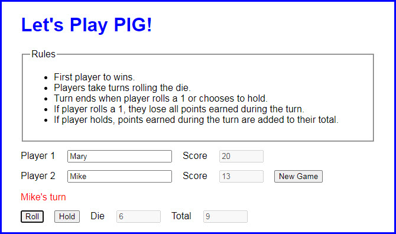

# PIG Game with Objects

## Expected result

This screenshot shows the interface provided in the original assignment. Mary and Mike are playing, with scores of 20 and 13. It is Mike’s turn, the die shows 6, and the current turn total is 9.

To start, enter both players’ names and click **New Game**. The message below the names identifies the current player. A dialog announces the winner when the game ends.

## Assignment steps

1. Review `library_die.js`. It defines a `Die` class with no properties and one method that rolls a die.
2. Review `library_pig.js`. It defines a `Pig` class that has a property containing an instance of `Die`. The class includes a constructor with five data properties, one read-only accessor property, and three methods.
3. Review `library_game.js`. It defines an object literal with three data properties, one read-only accessor property, and five methods. The `start()` method and read-only `isValid` property are already implemented. Complete the other four methods according to their comments, using cascading methods where possible.
4. Review `pig.js`. It provides the ready event handler and the **New Game** click handler. Complete the **Roll** and **Hold** click handlers using the methods of the game object defined in `library_game.js`.

## Code organization

| File | Role |
| --- | --- |
| `library_die.js` | Defines the `Die` class and its die-roll method |
| `library_pig.js` | Defines the `Pig` class, including its `Die` instance, player data, accessor, and methods |
| `library_game.js` | Defines the game object and coordinates game behavior |
| `pig.js` | Connects page events to the game object |

Use the names, comments, and existing behavior in the starter files to guide the implementation of the unfinished methods.

## Cascading methods

Where appropriate, return the current object from a method so another method can be called on the result. This allows method chaining. Preserve any return values required by existing callers.

## How to play PIG

PIG is a two-player dice game. The first player to bank **100 points or more** wins. Each turn is a choice between rolling again to earn more points and holding to keep the points already earned.

### Start the game

Enter a name for each player and click **New Game**. Both players start with a score of zero. The message below the names tells you whose turn it is.

### Understand the scores

Each player’s **Score** is the banked total accumulated across completed turns. The **Total** beside the die shows the points earned during the current turn. Those turn points remain at risk until the player chooses **Hold**.

### Roll the die

Click **Roll** to roll one six-sided die.

- If the die shows **2, 3, 4, 5, or 6**, that number is added to the current turn total. The player may roll again or hold.
- If the die shows **1**, the player loses all points earned during that turn. The turn total resets to zero, and play passes to the other player. Points banked during earlier turns stay safe.

There is no upper limit on the turn total that causes a player to lose the turn. A player can keep rolling, but every additional roll risks losing the unbanked points if a 1 appears.

### Hold to save points

Click **Hold** to add the current turn total to the player’s banked score. The turn total resets to zero, and the other player takes a turn unless the holding player has won.

### Win the game

Bank **100 points or more** to win. For example, a player with 94 banked points who earns 8 during a turn can hold to finish with 102 points and win. Exceeding 100 is allowed.

The application announces the winner in a dialog. Click **New Game** to start again.

### Example turns

Suppose Mary has 20 banked points.

| Action | Turn total | Mary’s banked score | What happens |
| --- | --- | --- | --- |
| Roll a 4 | 4 | 20 | Mary can roll again or hold |
| Roll a 5 | 9 | 20 | Mary can roll again or hold |
| Hold | 0 | 29 | The 9 points are saved, and Mike’s turn begins |

If Mary had rolled a 1 instead of holding, she would have lost the 9 turn points, kept her banked score of 20, and passed the turn to Mike.

## Manual checks

- Enter both player names and click **New Game**. Confirm that the game initializes and identifies the current player.
- Click **Roll** and confirm that the die value and turn total update according to the game rules.
- Confirm that rolling a 1 discards the turn’s points and passes the turn to the other player.
- Click **Hold** and confirm that the turn’s points are added to the player’s score before the turn changes.
- Continue until a player banks 100 points or more and confirm that a dialog announces the winner.
- Start a new game and confirm that the game state resets.
