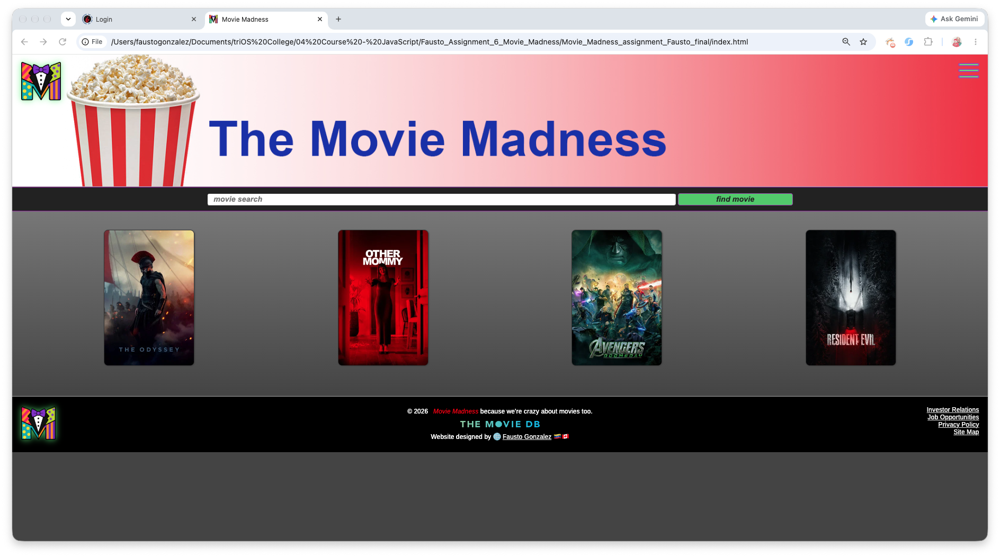
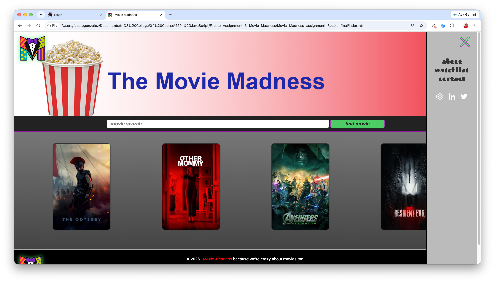
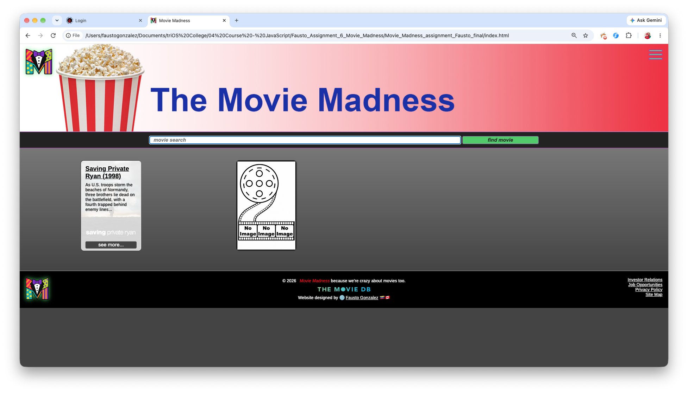
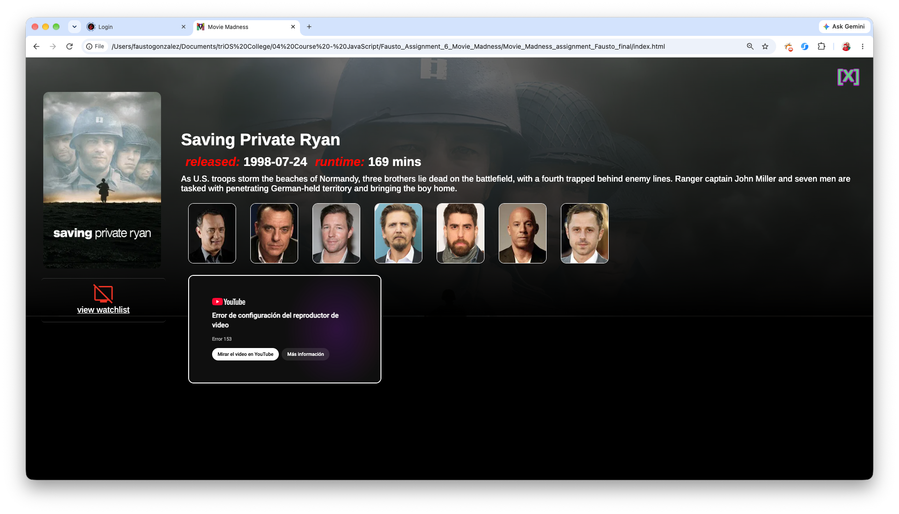
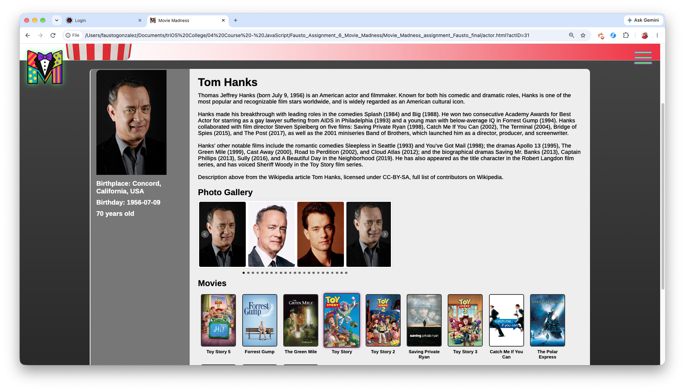
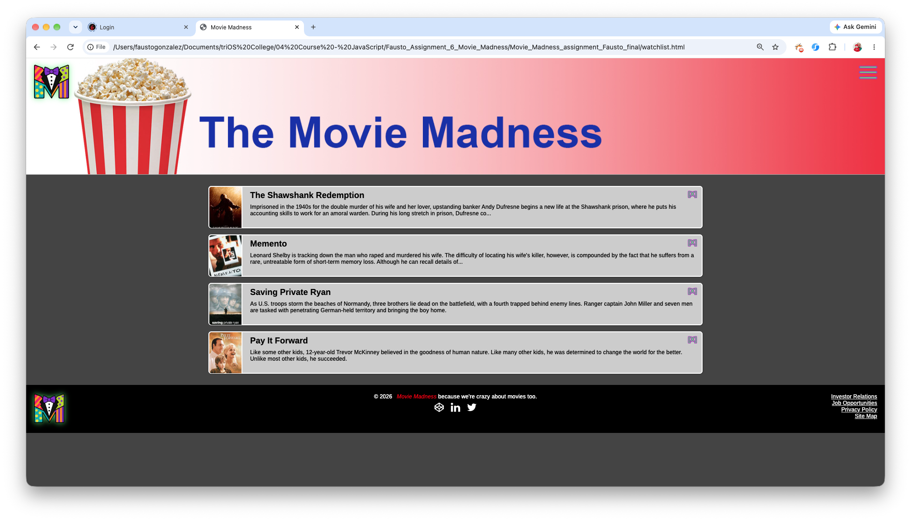
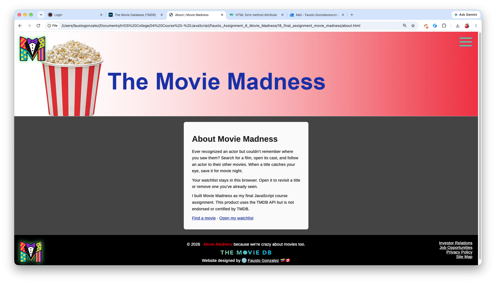
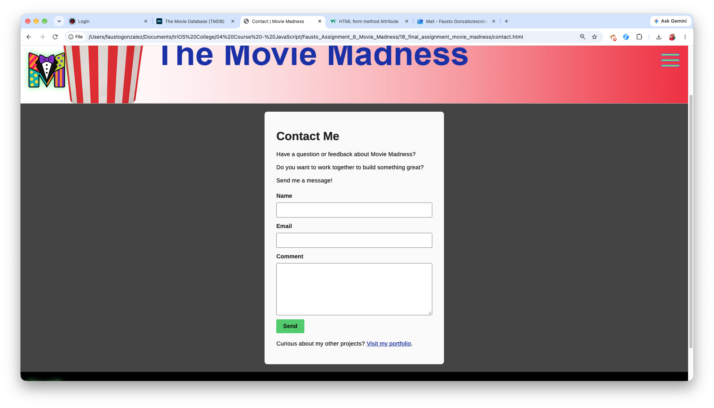

# Movie Madness

**Fausto Gonzalez · Final JavaScript course assignment**

I built Movie Madness to follow the connections between movies and actors. Search for *Saving Private Ryan*, open Tom Hanks’s profile from the cast, and browse his other films. When you find something for movie night, save it to your watchlist.

[See the screenshot walkthrough](#screenshots) · [Run locally](#run-locally)

## How it works

- **Movie search.** The home page loads trending movies from The Movie Database (TMDB). Search by title, hover over a result for a preview, and select **see more…** to open the movie details. The overlay includes a synopsis, release date, runtime, cast, and a trailer when available.
- **Actor discovery.** Select a cast photo to open the actor’s biography, personal details, photo carousel, and movie credits. Open a gallery photo in the lightbox, use the arrow keys to browse, and press Escape to close it.
- **Personal watchlist.** Select the watchlist icon under the movie poster to toggle a title. The Watchlist page shows saved titles with a poster, plot summary, and removal control. The app keeps the list in browser `localStorage` under `savedMovies`. Reopen the site in the same browser and origin to see it again.
- **Contact.** The form requires a name, email address, and comment. **Send** opens a prefilled feedback draft through the visitor’s configured email app. The visitor reviews and sends it there.

## Run locally

1. Open the assignment folder in VS Code.
2. In your **local copy** of `js/tmdb.js`, enter your own TMDB API key in the empty `api_key` constant. Keep the key out of commits and published JavaScript.
3. Serve `index.html` with VS Code Live Server. A valid key and an internet connection are needed for live movie and actor data. You can explore the screenshots below without a key.
4. Search for a title, open its details, and select the icon under the poster. Choose **view watchlist** to confirm the title was saved.

## Screenshots

### 1. Home

The home page opens with movie posters and a title search.

### 2. Side menu

The hamburger menu gives access to About, Watchlist, and Contact.

### 3. Search results

Hovering over Saving Private Ryan reveals a synopsis and the see more control. A placeholder fills in for a missing poster.

### 4. Movie details

The overlay shows the cast, release date, and 169-minute runtime. The embedded trailer was unavailable when this screenshot was taken.

### 5. Adding a movie

The watchlist icon changes from a red crossed-out screen to a green screen when the film is saved.

### 6. Actor profile

Tom Hanks’s profile includes a biography, photo gallery, and credits such as Forrest Gump and Toy Story.

### 7. Watchlist

Saving Private Ryan appears alongside three other saved films. Select the X on a row to remove that title.

### 8. About

The About page introduces the assignment, credits TMDB, and links to search and the watchlist.

### 9. Contact

The Contact Me page collects feedback and links to my portfolio.

## Code guide

| File | Role |
| --- | --- |
| `index.html`, `actor.html`, `watchlist.html` | Movie search, actor profiles, and saved titles |
| `about.html`, `contact.html` | Project background and feedback form |
| `js/tmdb.js` | TMDB requests, rendering, gallery interactions, and watchlist persistence |
| `js/Movie.js`, `js/Actor.js` and related classes | Represent movie, cast, credit, and video data |
| `js/app.js`, `js/contact.js` | Shared menu interactions and contact email draft |
| `css/app.css` | Grid layout and page styling |

Built with HTML, CSS Grid, JavaScript, jQuery, and bxSlider. Movie data and images come from [The Movie Database](https://www.themoviedb.org/). This product uses the TMDB API but is not endorsed or certified by TMDB.
